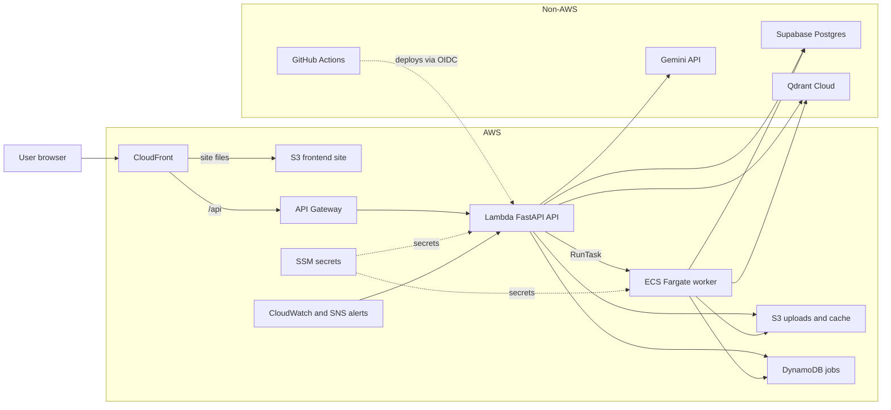
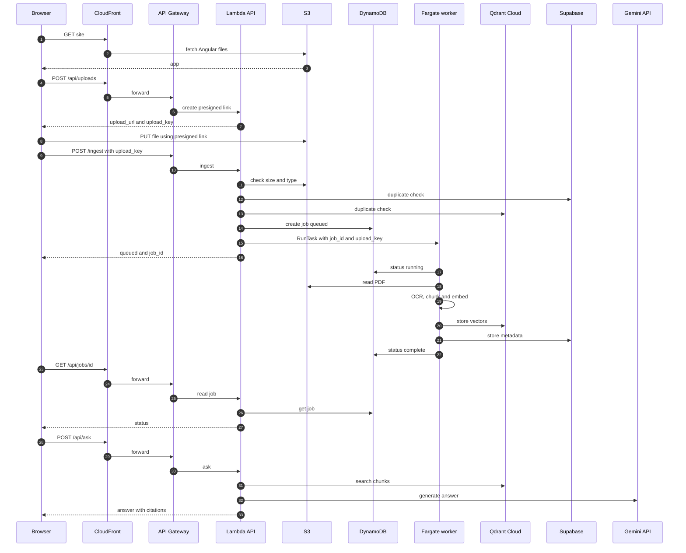

# Architecture

```
                       ┌────────────────────┐
                       │ Client · UI · eval │
                       └──────────┬─────────┘
                                  │
┌─────────────────────────────────▼────────────────────────────────┐
│ api/  FastAPI                                                    │
│ /ingest  /jobs  /documents  /ask  /health                        │
└───────────────┬──────────────────────────────────┬───────────────┘
                │                                  │
┌───────────────▼───────────────┐  ┌───────────────▼───────────────┐
│ ingest/                       │  │ query/                        │
│ 1 ids                         │  │ search                        │
│ 2 pdf_reader                  │  │ answer                        │
│ 3 chunker                     │  │                               │
│ 4 embeddings                  │  │                               │
│ 5 store                       │  │                               │
└───────────────┬───────────────┘  └───────────────┬───────────────┘
                │                                  │
┌───────────────▼──────────────────────────────────▼───────────────┐
│ utils/                                                           │
│ llm factory   vectorstore factory   metadata factory             │
│ prompts       page_cache            vector_cache       ocr       │
└─────┬─────────────┬─────────────┬─────────────┬─────────────┬────┘
      │             │             │             │             │
┌─────▼─────┐ ┌─────▼─────┐ ┌─────▼─────┐ ┌─────▼─────┐ ┌─────▼────┐
│ Gemini    │ │ Qdrant    │ │ Postgres  │ │ Tesseract │ │ Disk     │
└───────────┘ └───────────┘ └───────────┘ └───────────┘ └──────────┘
```

Each layer only calls the one below it.

| Layer | Role |
|---|---|
| `api/` | HTTP endpoints, API-key check, background ingestion jobs |
| `api/risky_delete_apis` | Guarded delete endpoints (off by default; admin key + dry run + confirm) |
| `api/backup_apis` + `ops/backup.py` | Guarded backup / restore of Postgres + Qdrant as one file (off by default) |
| `ingest/` | PDF → pages → chunks → vectors → vector store, with dedup |
| `query/` | Question → search → answer with page citations |
| `utils/llm` | LLM factory; provider per role (vision, answer, embed) set in `.env` |
| `utils/vectorstore` | Vector DB factory; `VECTOR_STORE` set in `.env` |
| `utils/metadata` | Metadata factory (companies, doc types, filings); `METADATA_STORE=postgres` |
| `utils/` (rest) | Prompts, OCR, page and vector caches |

Diagram source: `docs/architecture_diagram.py` (regenerates and checks alignment).

## AWS deployment (aws-serverless)

The diagrams below show the AWS version. Non-AWS services are in their own group. They render on GitHub.

### Architecture



### End-to-end flow


