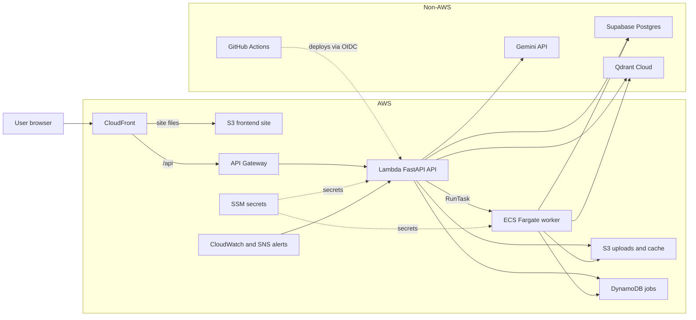
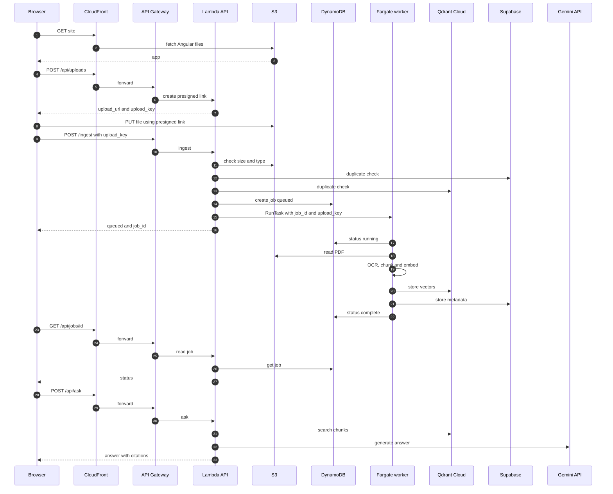

# Architecture

```
                       ┌────────────────────┐
                       │ Client · UI · eval │
                       └──────────┬─────────┘
                                  │
┌─────────────────────────────────▼────────────────────────────────┐
│ api/  FastAPI                                                    │
│ /ingest  /jobs  /documents  /ask  /health                        │
└───────────────┬──────────────────────────────────┬───────────────┘
                │                                  │
┌───────────────▼───────────────┐  ┌───────────────▼───────────────┐
│ ingest/                       │  │ query/                        │
│ 1 ids                         │  │ search                        │
│ 2 pdf_reader                  │  │ answer                        │
│ 3 chunker                     │  │                               │
│ 4 embeddings                  │  │                               │
│ 5 store                       │  │                               │
└───────────────┬───────────────┘  └───────────────┬───────────────┘
                │                                  │
┌───────────────▼──────────────────────────────────▼───────────────┐
│ utils/                                                           │
│ llm factory   vectorstore factory   metadata factory             │
│ prompts       page_cache            vector_cache       ocr       │
└─────┬─────────────┬─────────────┬─────────────┬─────────────┬────┘
      │             │             │             │             │
┌─────▼─────┐ ┌─────▼─────┐ ┌─────▼─────┐ ┌─────▼─────┐ ┌─────▼────┐
│ Gemini    │ │ Qdrant    │ │ Postgres  │ │ Tesseract │ │ Disk     │
└───────────┘ └───────────┘ └───────────┘ └───────────┘ └──────────┘
```

Each layer only calls the one below it.

| Layer | Role |
|---|---|
| `api/` | HTTP endpoints, API-key check, background ingestion jobs |
| `api/risky_delete_apis` | Guarded delete endpoints (off by default; admin key + dry run + confirm) |
| `api/backup_apis` + `ops/backup.py` | Guarded backup / restore of Postgres + Qdrant as one file (off by default) |
| `ingest/` | PDF → pages → chunks → vectors → vector store, with dedup |
| `query/` | Question → search → answer with page citations |
| `utils/llm` | LLM factory; provider per role (vision, answer, embed) set in `.env` |
| `utils/vectorstore` | Vector DB factory; `VECTOR_STORE` set in `.env` |
| `utils/metadata` | Metadata factory (companies, doc types, filings); `METADATA_STORE=postgres` |
| `utils/` (rest) | Prompts, OCR, page and vector caches |

Diagram source: `docs/architecture_diagram.py` (regenerates and checks alignment).

## AWS deployment (aws-serverless)

The diagrams below show the AWS version. Non-AWS services are in their own group. They render on GitHub.

### Architecture



### End-to-end flow



## End-to-end flow: stocks-platform on AWS

**Phase 0: Setup (once)**
1. Terraform creates the AWS resources: S3, DynamoDB, Lambda, API Gateway, CloudFront, ECS, ECR, CodeBuild, SSM, IAM, CloudWatch, SNS and EventBridge.
2. Secrets go into SSM Parameter Store, never into Git or Terraform files.
3. CodeBuild builds the worker image and pushes it to ECR.
4. GitHub Actions deploys through OIDC, so no AWS keys are stored.

**Phase 1: Browser loads the site**
1. The browser calls CloudFront.
2. CloudFront serves the Angular app from the S3 frontend bucket.
3. The app then calls `/api/...` through CloudFront.

**Phase 2: Lambda starts (a cold start only when no warm environment exists)**
1. Lambda starts an environment.
2. The code reads SSM secrets at startup (`SECRETS_FROM_SSM=true`).
3. FastAPI starts through Mangum.

**Phase 3: Upload (big files skip API Gateway)**
1. Browser → CloudFront → API Gateway → Lambda: `POST /uploads`.
2. Lambda returns a presigned S3 PUT URL and an `upload_key`. The link is valid for 15 minutes.
3. The browser sends the file straight to the S3 uploads bucket.

**Phase 4: Start ingestion**
1. Browser → API Gateway → Lambda: `POST /ingest` with `upload_key`, company, period and doc type.
2. Lambda checks the file size and type in S3.
3. Lambda checks Supabase and Qdrant for a duplicate. If one exists, it returns `skipped`.
4. Lambda writes the job as `queued` in DynamoDB.
5. Lambda calls ECS `RunTask` to start one Fargate worker with the job ID and upload key.
6. Lambda returns `queued` and `job_id`. If `RunTask` fails, the job becomes `failed` and the API returns 503.

**Phase 5: The worker does the heavy work**
1. The worker sets the job to `running` in DynamoDB.
2. It reads the PDF from S3. Scanned pages go through OCR.
3. It splits the pages into chunks.
4. It creates embeddings for each chunk.
5. It stores vectors in Qdrant and document metadata in Supabase. Page and vector results are cached in the S3 cache bucket.
6. It sets the job to `complete`, or `failed` if any page or chunk did not store.

If the worker crashes, an EventBridge rule raises an alarm through SNS. Known gap: a job that fails inside the worker exits with code 0 and does not alarm.

**Phase 6: Browser checks progress**
1. The browser polls `GET /api/jobs/{job_id}` through CloudFront, API Gateway and Lambda.
2. Lambda reads DynamoDB and returns `queued`, `running`, `complete`, `skipped` or `failed`.

**Phase 7: Ask a question**
1. Browser → `POST /api/ask` through CloudFront, API Gateway and Lambda.
2. Lambda validates the company, period and doc type before any model call.
3. Search finds the closest chunks in Qdrant, filtered by company, period and doc type.
4. Lambda sends the question and chunks to Gemini, and calls it again if the answer needs a rewrite.
5. Lambda returns the answer with file and page citations.

**Phase 8: Monitoring (runs throughout)**
- Lambda and API Gateway send logs and metrics to CloudWatch.
- Alarms (Lambda errors, throttles, API 5xx) and EventBridge rules go through SNS to email.
- AWS Budgets alerts at 80% and 100% of $20 a month.

*To confirm: the direct `/ingest` route (the docs say it goes straight to API Gateway), the embeddings provider, and the order of the duplicate checks.*
